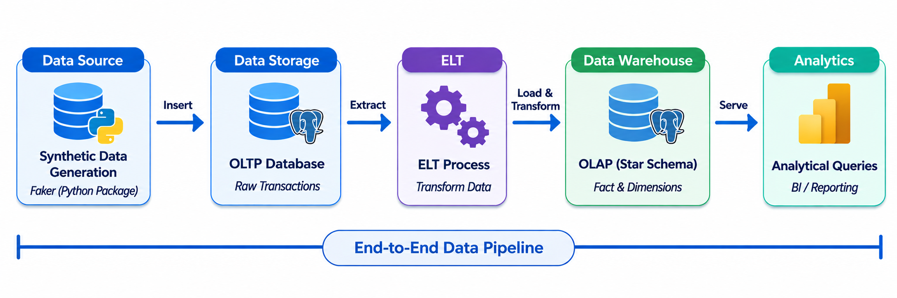
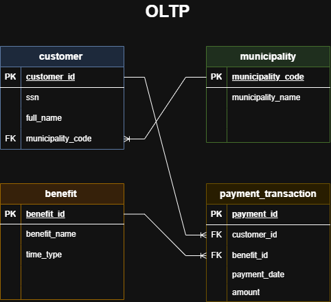
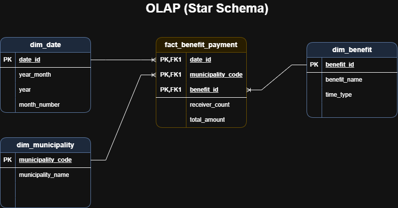

# Kela Data Pipeline

An automated ELT data pipeline built with Python and SQL, containerized with Docker. This project simulates processing benefit payments for Kela (The Social Insurance Institution of Finland), transforming normalized operational data into an optimized, strictly anonymized Star Schema for secure analytical reporting.

## 🎯 Problem & Context

Raw operational data (simulated Kela benefit payments) is continuously generated into a normalized OLTP database. While this schema is optimal for fast, individual daily transactions, it is not structured for analytical workloads. Analysts need to answer:

- How are specific benefit payments distributed across different municipalities?
- What are the monthly trends in total payment amounts and recipient counts?
- Which regions require the most financial support for specific benefits?

**Challenge:** Querying the operational database directly for large-scale aggregations is slow, resource-heavy, and crucially, risks exposing sensitive Personally Identifiable Information (PII) such as Social Security Numbers (SSN/HETU) and full names. Data teams need a secure, optimized data warehouse that separates transactional processing from analytical reporting.

**Solution:** An automated, containerized ELT pipeline that extracts raw data from the operational schema, strictly anonymizes it by dropping all PII, and transforms it into an optimized Star Schema (OLAP). By pre-aggregating data into specialized fact and dimension tables, the pipeline provides a secure, high-performance single source of truth for BI and reporting tools.

## 🏗️ Architecture



## 🗄️ Data Models

This project demonstrates the fundamental data engineering process of transforming data from a normalized operational system into an analytical schema.

### 1. OLTP Database (Source)
The source database simulates an operational system (OLTP) that handles daily transactions.
* **Structure:** Normalized relational model.
* **Purpose:** Optimized for fast data entry (inserts/updates) and maintaining strict data integrity during daily benefit processing.



### 2. OLAP Data Warehouse (Target)
The target data warehouse is modeled using a Star Schema (OLAP) to serve analytical needs.
* **Structure:** Denormalized into a central Fact table (benefit payments) surrounded by descriptive Dimension tables (e.g., Date, Customer, Municipality).
* **Purpose:** Optimized for fast read performance, complex aggregations, and Business Intelligence (BI) reporting.



## 🛠 Tech Stack

- **Database:** PostgreSQL (Containerized, hosting both OLTP source and OLAP target schemas)
- **Language:** Python (Data generation & ELT execution) & SQL (DDL for schemas, DML for transformations)
- **Data Model:** Normalized OLTP (Source) ➔ Star Schema OLAP (Target with fact & dimension tables)
- **Development:** VS Code (Python/SQL editing), draw.io (Designing visual ER diagrams)
- **Automation:** Bash (`run_elt.sh` as the master orchestrator script)
- **Version Control:** Git & GitHub (Versioned pipeline scripts)
- **Infrastructure:** Docker & Docker Compose (Multi-container architecture with internal networking)
- **Package Management:** `uv` (Lightning-fast Python dependency resolution)

## 📂 Project Structure

```text
kela-data-pipeline/
├── docker-compose.yaml             # Multi-container Docker configuration
├── Dockerfile                      # Python environment build instructions
├── pyproject.toml / uv.lock        # Dependencies managed by uv
├── run_elt.sh                      # Bash orchestrator for the pipeline
├── logs/                           # Automated execution logs
├── sql/                            # SQL scripts
│   ├── 01_create_oltp.sql          # Operational schema definition
│   ├── 02_create_olap.sql          # Star schema definition
│   └── 03_elt_process.sql          # Transformation logic
├── src/                            # Python source code         
│   ├── database_connection.py      # Database connection handler
│   ├── elt_process.py              # ELT execution 
│   ├── generate_data.py            # Synthetic data generator using Faker
│   ├── logger.py                   # Centralized logging configuration
│   ├── orchestrator.py             # Main Python orchestrator
│   └── setup_database.py           # Schema initialization
└── tests/                          # Data quality assurance
    ├── data_quality_tests.json     # Dynamic test configurations
    └── test_data_quality.py        # Data quality test execution engine
```

## 🚀 Quick Start

### 1. Clone the repository
```bash
git clone https://github.com/yourusername/kela-data-pipeline.git
cd kela-data-pipeline
```

### 2. Configure Environment
Create a `.env` file in the project root with the following credentials:
```env
DB_HOST=localhost
DB_PORT=5433
DB_NAME=kela_dw
DB_USER=kela_admin
DB_PASSWORD=your_secure_password
```
*(Note: Docker handles the internal networking automatically. The `DB_HOST` and `DB_PORT` values allow you to connect to the database externally using tools like DBeaver or pgAdmin).*

### 3. Run the Pipeline
The entire architecture (PostgreSQL database and Python environment) is fully containerized. Start the database, initialize the environment, and run the complete ELT pipeline with a single command:
```bash
docker compose up --build
```

## ⚙️ How It Works

1. **Database Setup:** Reads SQL files and initializes both OLTP (source) and OLAP (destination) schemas.
2. **Data Generation:** Uses the Python `Faker` library to generate synthetic customer and benefit data, simulating Kela's operational systems.
3. **ELT Process:** Extracts raw data from the OLTP tables and transforms it into a star schema (fact and dimension tables) optimized for analytics.
4. **Logging:** All actions, including execution times and potential errors, are automatically logged into the `logs/` directory.
5. **Data Quality Assurance:** To ensure the reliability of the analytical data, the pipeline executes automated data quality checks as its final step. Instead of hardcoded Python tests, this project uses a modern, **metadata-driven testing engine**:
* **Config-Driven Rules:** Test definitions are decoupled from the code and stored in `tests/data_quality_tests.json`, mimicking industry-standard tools like dbt or Great Expectations.
* **Uniqueness:** Ensures no duplicate records exist for the composite primary key (`date_id`, `municipality_code`, `benefit_id`) using `GROUP BY ... HAVING` logic.
* **Completeness:** Validates that critical business metrics (e.g., `total_amount`) contain no `NULL` values.
* **Referential Integrity:** Verifies that all fact table records correctly map to existing dimension tables.

If any check fails, the pipeline logs the specific violation and halts with a non-zero exit code, preventing corrupted data from being served to the BI layer.

## 🔒 Data Privacy & Anonymization

Handling sensitive social security data requires strict adherence to privacy laws (e.g., GDPR). This project demonstrates best practices in data anonymization:
* **Synthetic Source Data:** All source data (including Finnish Social Security Numbers / *Hetu* and names) is 100% synthetically generated using the `Faker` library. No real customer data is used.
* **Analytical Aggregation:** During the ELT transformation process, all Personally Identifiable Information (PII) is intentionally stripped. The resulting OLAP Star Schema does not contain names or SSNs—only aggregated receiver counts and financial totals per municipality and benefit type. This ensures the analytical data is fully anonymized and safe for broad Business Intelligence reporting.

## 📊 Analytical Queries

The pipeline transforms the raw data into a Star Schema (OLAP), enabling fast and intuitive business intelligence queries. The fact table is already pre-aggregated for high performance. Here are a few examples of what you can analyze:

**1. Total benefits paid per month and benefit type:**
```sql
SELECT 
    d.year, 
    d.month_number, 
    b.benefit_name, 
    SUM(f.total_amount) AS total_paid_amount
FROM fact_benefit_payment f
JOIN dim_date d ON f.date_id = d.date_id
JOIN dim_benefit b ON f.benefit_id = b.benefit_id
GROUP BY d.year, d.month_number, b.benefit_name
ORDER BY d.year DESC, d.month_number DESC;
```

**2. Total payments and monthly receiver volumes by municipality:**
```sql
SELECT 
    m.municipality_name,
    SUM(f.receiver_count) AS total_monthly_receivers,
    SUM(f.total_amount) AS total_regional_payments
FROM fact_benefit_payment f
JOIN dim_municipality m ON f.municipality_code = m.municipality_code
GROUP BY m.municipality_name
ORDE
```

**3. Regional breakdown for a specific benefit (e.g., analyzing only "Työttömyysturva" / Unemployment benefit):** 
```sql
SELECT 
    m.municipality_name,
    b.benefit_name,
    SUM(f.receiver_count) AS total_receivers,
    SUM(f.total_amount) AS total_paid_amount
FROM fact_benefit_payment f
JOIN dim_municipality m ON f.municipality_code = m.municipality_code
JOIN dim_benefit b ON f.benefit_id = b.benefit_id
WHERE b.benefit_name = 'Työttömyysturva' -- Adjust to any benefit name in your data
GROUP BY m.municipality_name, b.benefit_name
ORDER BY total_paid_amount DESC
LIMIT 10;